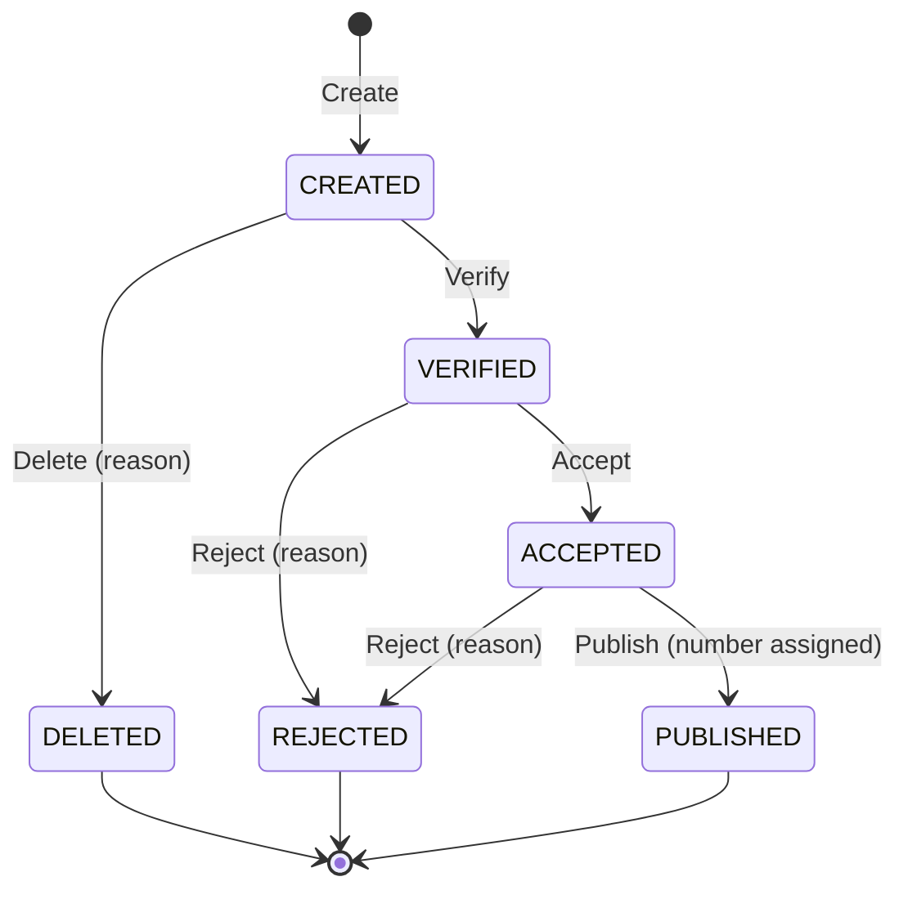

# Request Manager

A backend service that manages the lifecycle of requests. A request is created with a name
and content, moves through the states of the diagram below, and every state change is
recorded in an audit log. Published requests get a unique numeric publication number.
The service exposes a REST API and stores data in PostgreSQL.

Decisions on anything the task description leaves open are listed in
[ASSUMPTIONS.md](ASSUMPTIONS.md).

## State diagram



Content can be edited only in `CREATED` and `VERIFIED`.

## Architecture

Hexagonal architecture split into three Maven modules. Dependencies point inwards only,
and the compiler enforces it: the domain cannot import Spring, JPA or anything from the
outer modules.

```
infrastructure  ──▶  application  ──▶  domain
```

| Module | Contents | Framework |
|---|---|---|
| `domain` | `RequestRoot` aggregate, states, actions, `StateChange` history, `TransitionPolicy` with the diagram, domain exceptions | none (plain Java) |
| `application` | use case ports (`port/in`), repository and number generator ports (`port/out`), `RequestService` | none (plain Java) |
| `infrastructure` | Spring Boot app, REST controller, JPA persistence adapter, Flyway migrations, transactional decorator, error mapping | Spring Boot |

Key design points:

- **The diagram is data.** Allowed transitions live in one table in `DiagramTransitionPolicy`
  behind the `TransitionPolicy` interface. Changing the arrows of the diagram means changing
  that table (or providing another policy bean), not the aggregate.
- **The aggregate guards its rules**: mandatory fields, editable states, required reason,
  publication number assigned only after a successful transition, history appended on every
  state change.
- **Transactions without annotations in the core.** `TransactionalRequestService` in the
  infrastructure wraps each use case in one transaction; it is the only bean exposing the
  use case ports.
- **Unique publication numbers** come from a PostgreSQL sequence, backed by a `UNIQUE`
  constraint on the column.

## Tech stack

Java 21, Spring Boot 4.1, PostgreSQL 17, Spring Data JPA, Flyway, JUnit 5, AssertJ,
Testcontainers.

## Requirements

- JDK 21
- Docker (running) – used for the database when running the app and by the tests

## Running

```bash
./mvnw install -DskipTests
./mvnw -pl infrastructure spring-boot:run
```

On Windows use `mvnw.cmd`. Spring Boot starts PostgreSQL from [docker-compose.yml](docker-compose.yml)
automatically, Flyway creates the schema, and the API is available at `http://localhost:8080`.

To use another database, set `DB_URL`, `DB_USER` and `DB_PASSWORD`.

## Tests

```bash
./mvnw verify
```

| Layer | What is tested | How |
|---|---|---|
| domain | every state × action combination, all aggregate rules | plain unit tests |
| application | use cases | unit tests with in-memory fakes |
| persistence | mapping, history, search, sequence uniqueness under concurrency | `@DataJpaTest` on PostgreSQL (Testcontainers) |
| web | status codes, JSON, error mapping | `@WebMvcTest` with mocked use cases |
| end-to-end | full lifecycle and errors over real HTTP | `@SpringBootTest` on PostgreSQL (Testcontainers) |

## API

| Method | Path | Body | Result |
|---|---|---|---|
| `POST` | `/requests` | `{"name", "content"}` | `201` + `Location`, the request |
| `GET` | `/requests/{id}` | | the request |
| `PUT` | `/requests/{id}/content` | `{"content"}` | the request |
| `POST` | `/requests/{id}/transitions` | `{"action", "reason"}` | the request |
| `GET` | `/requests/{id}/history` | | list of state changes |
| `GET` | `/requests?name=&state=&page=0&size=10` | | page of requests |

`action` is one of `VERIFY`, `ACCEPT`, `PUBLISH`, `DELETE`, `REJECT`; `reason` is required
for `DELETE` and `REJECT`.

```bash
# create
curl -i -X POST localhost:8080/requests \
  -H 'Content-Type: application/json' \
  -d '{"name": "Invoice March", "content": "Please approve"}'

# verify, accept, publish
curl -X POST localhost:8080/requests/{id}/transitions \
  -H 'Content-Type: application/json' -d '{"action": "VERIFY"}'

# reject with a reason
curl -X POST localhost:8080/requests/{id}/transitions \
  -H 'Content-Type: application/json' -d '{"action": "REJECT", "reason": "Missing data"}'

# history
curl localhost:8080/requests/{id}/history

# browse: name fragment, state, paging
curl 'localhost:8080/requests?name=invoice&state=VERIFIED&page=0&size=10'
```

Request:

```json
{
  "id": "6f1c2c1e-1b7e-4c55-9a59-2a8f8f0c3b1d",
  "name": "Invoice March",
  "content": "Please approve",
  "state": "PUBLISHED",
  "publicationNumber": 1
}
```

### Errors

Errors follow [RFC 9457](https://www.rfc-editor.org/rfc/rfc9457) problem details
(`application/problem+json`):

| Status | When |
|---|---|
| `400` | missing or too long field, missing reason, malformed JSON, unknown action or state, invalid paging |
| `404` | request does not exist |
| `409` | transition not allowed by the diagram, content not editable in the current state |
| `422` | any other business rule violation |

```json
{
  "title": "Conflict",
  "status": 409,
  "detail": "Action PUBLISH is not allowed in state CREATED",
  "instance": "/requests/6f1c2c1e-1b7e-4c55-9a59-2a8f8f0c3b1d/transitions",
  "state": "CREATED",
  "action": "PUBLISH"
}
```
